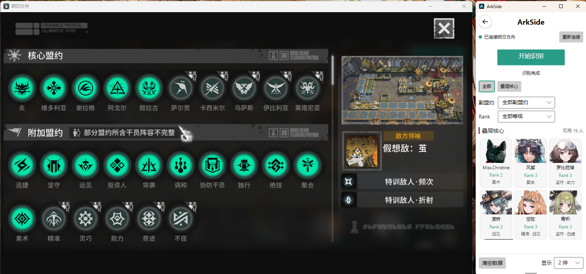

# ArkSide

ArkSide 是明日方舟的桌面侧栏助手：连接游戏窗口，在盟约确认页面截图并离线识别禁用盟约，结合干员数据展示推荐，支持标签、副盟约和 Rank 筛选。

识别在本机完成，发布包自带 .NET、Python 运行时和 OCR 模型，无需额外安装这些依赖。游戏需要自行启动。



## 下载

到 [GitHub Releases](https://github.com/xiaogewzw/ArkSide/releases) 下载对应平台的应用 ZIP。支持 Windows x64 和 macOS Apple Silicon（M 系列）。Windows 需要安装 VC++ x64 运行库。macOS 包内原生组件最低要求为 macOS 15，目前仅在 macOS 27 上通过真机测试，其他系统版本兼容性待确认。

`v1.0.0` 为首个正式版本。

| 平台 | v1.0.0 应用附件 |
| --- | --- |
| Windows x64 | `ArkSide-v1.0.0-Windows-x64.zip` |
| macOS Apple Silicon | `ArkSide-v1.0.0-macOS-arm64.zip` |


## 启动和识别

1. Windows：完整解压，进入 `ArkSide` 文件夹，双击 `ArkSide.exe`。保留同目录下的所有文件。
2. macOS：解压后将 `ArkSide.app` 移到“应用程序”，双击启动。首次截图时，在“系统设置 → 隐私与安全性 → 录屏与系统录音”中允许 ArkSide，然后重启助手。
3. 启动明日方舟。助手默认按 Windows 的 `Arknights.exe` 或 macOS 的 `com.hypergryph.arknights` 查找游戏，找到后吸附到游戏窗口右侧。需要时点击“重新连接”。
4. 游戏进入所有盟约都显示完整的页面，点击“开始识别”。完成后按标签、副盟约、Rank 和显示排数查看推荐。
5. 游戏内更换盟约后，再次点击“开始识别”。识别期间和识别失败后会保留上次成功结果；只有识别成功才整体替换，点击“清空数据”可主动清除。

**macOS 首次打开被拦截时**：当前应用尚未经过 Apple 公证，浏览器下载后首次启动可能提示“Apple 无法验证 ArkSide.app 是否包含恶意软件”。确认应用来自本项目的 GitHub Releases 后，点击弹窗中的“完成”，打开“系统设置 → 隐私与安全性”，向下滚动至“安全性”，找到 ArkSide 的拦截提示并点击“仍要打开”，按系统提示验证身份，再点击“打开”。允许后，后续通常可以直接双击启动。首次截图仍需按上述步骤单独授予录屏权限并重启助手。

## 自定义干员标签与适用副盟约

修改 `干员详细信息.json`，可以自定义推荐标签，以及干员在不同标签下显示的适用副盟约。正式应用首次运行时，会将默认的两份干员 JSON 复制到以下用户数据目录：

- Windows：`%LocalAppData%\ArkSide\recognition\data\干员详细信息.json`，可将目录粘贴到资源管理器地址栏打开。
- macOS：`~/Library/Application Support/ArkSide/recognition/data/干员详细信息.json`，可在 Finder 中按 `⌘⇧G`，粘贴目录并前往。

同目录还有 `干员禁用规则.json`，识别组件和推荐列表共用这两份配置。头像和 OCR 模型仍由应用包提供。自定义标签只需修改上面的 `干员详细信息.json`，无需重新打包或签名。

在原文件对应位置修改，并保留其他干员与字段。以下以纯烬艾雅法拉为例：

```json
{
  "allowedTags": ["输出核心", "叠层核心"],
  "operators": [
    {
      "id": "098",
      "name": "纯烬艾雅法拉",
      "tag": ["叠层核心"],
      "tagCovenants": {
        "叠层核心": ["聚合"]
      },
      "portrait": "头像_纯烬艾雅法拉.png",
      "mainCovenant": ["莱塔尼亚"],
      "viceCovenant": ["聚合", "远见"],
      "rank": 5
    }
  ]
}
```

| 字段 | 自定义规则 |
| --- | --- |
| `allowedTags` | 位于文件最外层，与 `operators` 同级，是所有干员共用的标签白名单。新增标签时先在这里登记，再加入相应干员的 `tag`。 |
| `tag` | 每个干员的标签字符串数组，可以填写多个标签，如 `["输出核心", "叠层核心"]`，该干员会进入对应的多个推荐分组。未列入 `allowedTags` 的标签会被忽略；`[]` 表示不进入任何标签推荐组。 |
| `tagCovenants` | 字段名末尾有 `s`，内容是“标签名 → 副盟约字符串数组”的对象，用于控制该标签下卡片显示的副盟约。键使用该干员 `tag` 中的标签名，数组中的盟约必须属于该干员的 `viceCovenant`，否则读取失败。单独填写映射不会为干员增加标签。 |

示例中，纯烬艾雅法拉属于“叠层核心”组，头像卡片下只显示“聚合”。仍然可以通过副盟约“远见”筛选出她，因为筛选始终匹配完整的 `viceCovenant`；推荐还会受本次禁用结果和 Rank 筛选约束。

- 某个标签没有对应的 `tagCovenants` 配置时，显示完整的 `viceCovenant`；省略整个字段或写成 `{}` 都使用此默认规则。
- 明确写成 `"叠层核心": []` 时，该标签下显示“无适用副盟约”，干员仍属于这个标签组。
- 标签去除首尾空白并去重，区分大小写；数组中不能有空字符串。`allowedTags` 缺失或为空时，不显示标签推荐。

使用 UTF-8 保存为合法 JSON，之后点击“开始识别”，应用会重新读取配置并生成推荐。修改前请备份；现有用户 JSON 在重启和升级时均会保留，格式错误会提示“干员详细资料异常”，不会自动覆盖你的文件。

需要恢复随应用提供的默认数据时，退出助手，将用户数据目录中对应的 JSON 备份并移走，下次启动会自动补齐缺失的文件。升级带来新版默认数据时，也可用此方法恢复，再重新应用自定义标签。已有包内修改可在首次运行前将两份 JSON 复制到上述用户目录。

从源码制作默认数据时，修改仓库中的 `干员数据/干员详细信息.json` 后重新构建；新的默认文件不会覆盖已经存在的用户配置。开发模式（未设置 `ArkSideProduction=true`）仍读取构建输出目录中的数据。

## 常见问题

- **没有找到游戏**：先启动游戏，再点击“重新连接”。
- **没有截图权限**：在 macOS 系统设置中授权录屏，之后重启助手。
- **截图异常**：将游戏恢复为可见窗口，确认目标进程正确后重试。
- **请将游戏画面调整到所有盟约都显示出来**：当前画面不完整或无法可靠识别，返回完整盟约页面后重试。
- **干员详细资料异常**：检查上面用户数据目录中的两份 JSON 是否符合格式；需要恢复默认时，先备份并移走出错文件，再启动助手。缺少头像或模型时，重新完整解压应用。

反馈问题请到 [Issues](https://github.com/xiaogewzw/ArkSide/issues)，提供应用版本、系统版本、游戏运行方式、复现步骤，以及对应时间的日志片段。包内 `release.json` 记录版本和源码提交，Mac 位于 `ArkSide.app/Contents/Resources/release.json`，Windows 位于 `ArkSide/release.json`。分享截图和日志前，请去除账号及个人路径信息。

## 文档和资源来源

ArkSide 图标和干员 JSON 由项目作者制作，干员头像取自 [PRTS Wiki](https://prts.wiki/)。相关游戏素材的权利归各自权利人。
